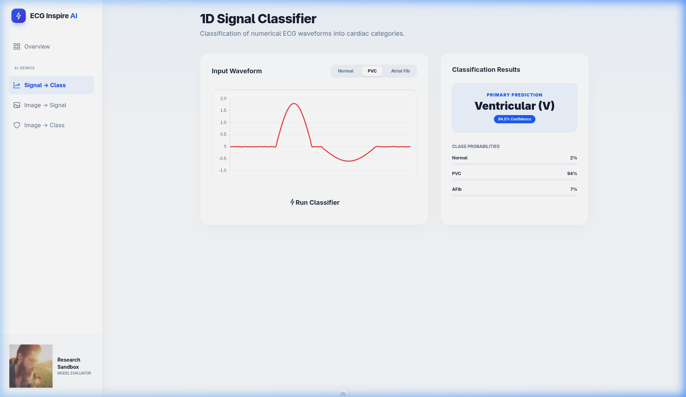
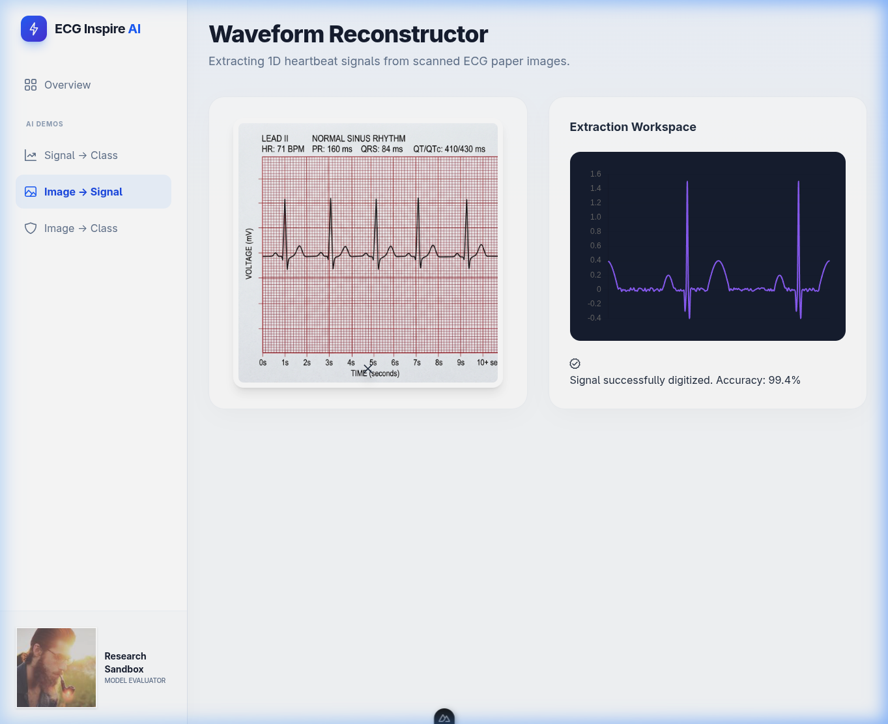
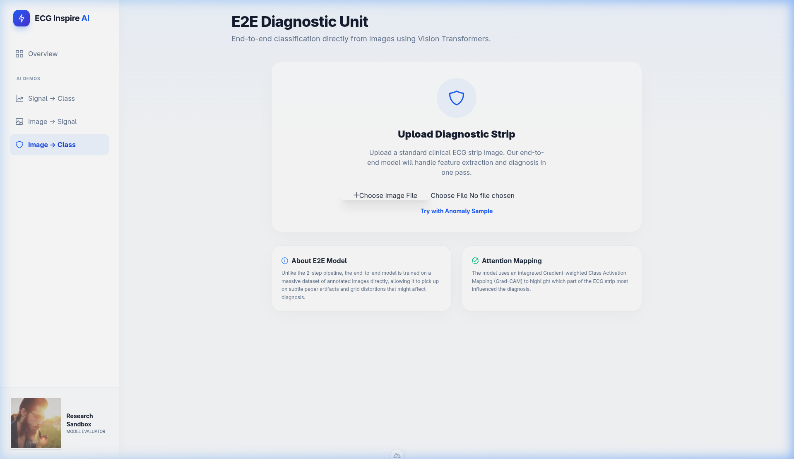

# ECG Arrhythmia Classification and Waveform Reconstruction

Deep Learning mini-project (module "Deep Learning", ESI-SBA, academic year 2025/2026).
The project explores three ways of getting from an ECG to a heartbeat diagnosis: classifying the
1D signal directly, classifying a picture of the ECG, and reconstructing the 1D signal from a picture.
Four 1D architectures (ResNet, BiLSTM, CNN+LSTM+Transformer hybrid, multi-scale "PhysioWave-inspired"
Transformer) are compared on the MIT-BIH heartbeat dataset (Kaggle CSV version), two image-based pipelines
are added, and a Nuxt web UI presents the three tasks. The repository also contains the LaTeX report and
the notebooks used along the way.

> **Read this first.** The web UI is a front-end mock-up: it does not load any trained model (details in
> [Limitations](#limitations-and-honest-notes)). The result numbers below come from the written report;
> the repository does not contain the training logs or notebook outputs that would let you re-check them.
> This is a course project, not a medical device.

## Problem

An ECG is a recording of the heart's electrical activity; each heartbeat has a P wave, a QRS complex and a
T wave. Reading long recordings by hand is slow, and many ECGs exist only as paper or scans. The project
asks three questions (see `notebooks/final_approach/0_research_and_problematic.ipynb`):

1. **Signal -> Class:** can a network classify a heartbeat from the raw 1D signal?
2. **Image -> Signal:** can a network digitise a picture of an ECG back into a 1D signal?
3. **Image -> Class:** can a network classify the picture directly, skipping digitisation?

Classes are the five AAMI heartbeat categories used by the MIT-BIH Kaggle dataset: Normal (N),
Supraventricular ectopic (S), Ventricular ectopic (V), Fusion (F), Unknown (Q).

## Data

- **MIT-BIH Arrhythmia Database, pre-segmented Kaggle version** (`shayanfazeli/heartbeat`, files
  `mitbih_train.csv` and `mitbih_test.csv`): one row per heartbeat, 187 samples plus the class label in the
  last column. The data is not stored in this repository (it is git-ignored); download it from Kaggle into `data/`.
- **Split in the training script** (`experiments/signal_to_class/v4/ecg_training_v4.py`): 80 % / 20 % random
  split of `mitbih_train.csv` for train / validation; `mitbih_test.csv` is used as the test set.
- **Images are synthetic:** the image pipelines plot the 1D beats into 2D pictures (the report describes grid
  lines, noise and varying line width; the notebooks draw simple line plots). There is no dataset of real scanned ECGs.
- Dataset sizes and class counts are not stated anywhere in the repository, so they are not quoted here.

## Approach

```
                          MIT-BIH heartbeats (187-sample 1D signals, 5 classes)
                                          |
        +---------------------------------+----------------------------------+
        |                                                                    |
   1D signal                                                      render signal as 2D picture
        |                                                                    |
   [Signal -> Class]                                          +--------------+---------------+
   ResNet / BiLSTM /                                          |                              |
   CNN+LSTM+Transformer /                           [Image -> Signal]              [Image -> Class]
   multi-scale Transformer                          CNN regressor, 187 outputs     2D CNN / ResNet-50 (report)
        |                                                     |                              |
   class (N,S,V,F,Q)                                1D signal (reconstructed)          class (N,S,V,F,Q)
                                                              |
                                                (could feed the 1D classifier)
```

**Signal -> Class** (`experiments/signal_to_class/v4/ecg_training_v4.py`, PyTorch). Four models share one
interface and one trainer:

| Model | Description (from the code) |
|---|---|
| `ECG_ResNet` | 1D residual network, block layout [3, 4, 6, 3], 64/128/256/512 channels, global average pooling |
| `ECG_LSTM` | 2-layer bidirectional LSTM, 128 hidden units per direction |
| `ECG_MultiModule` | Conv1d (32 ch) -> bidirectional LSTM (64 hidden) -> 2-layer Transformer encoder (d=128, 8 heads) |
| `ECG_PhysioWave` | parallel Conv1d with kernel sizes 3/7/11 -> 1x1 fusion -> 3-layer Transformer encoder (d=64, 4 heads) |

Training configuration in the script: Adam (lr 1e-3), batch size 128, 30 epochs, mixed precision (AMP),
Focal Loss (gamma 2), `ReduceLROnPlateau`, augmentation by noise injection and small temporal shift.
"PhysioWave-inspired" means inspired by the idea, not a re-implementation of the PhysioWave paper.

**Image -> Signal** and **Image -> Class.** The report describes a U-Net-style digitiser and a ResNet-50 /
Vision Transformer image classifier trained as Kaggle kernels. The kernel code itself is not in the repository.
What is in the repository are small stand-ins: `notebooks/final_approach/2_train_image_to_signal.ipynb`
(3-layer 2D CNN regressing 187 values from a 128x128 image) and `3_train_image_to_class.ipynb` (3-layer 2D CNN
classifier), both configured as quick demos (10 % sample, first 200 beats, 2 epochs), plus a Keras version in
`experiments/image_to_signal/v1`.

## Results

Source for every number in this table: the report, `report/Chapters/04_Results.tex`
(compiled in `report/DL_Mini_Project_Report.pdf`). Values are quoted as written there.

| Pipeline | Metric reported | Value (as written in the report) |
|---|---|---|
| Signal -> Class, four models | Test accuracy / weighted F1 | 100 % / 1.00 |
| Signal -> Class, four models | Train and validation accuracy, F1 (per model) | "~100%" and "~1.0" for ECG_ResNet, ECG_LSTM, ECG_MultiModule, ECG_PhysioWave; "~22/30" epochs to converge |
| Image -> Signal (U-Net) | Train loss / validation loss | 0.016909 / 0.016022 (summary table: "MSE: 0.016") |
| Image -> Class (ResNet-50) | Test accuracy (summary table) / F1 (results table) | 82 % / 0.82 |

How to read these numbers:

- The report itself states that near-100 % on this dataset "is NOT a medical breakthrough": every row is
  already a single segmented heartbeat, which is much easier than continuous ECG.
- The four signal models are reported as indistinguishable (all about 100 %), so the report gives no ranking between them.
- The report gives no per-class results, no confusion matrix and no comparison with a baseline.
- The numbers are not reproducible from this repository: the notebooks contain no saved outputs and the
  Kaggle logs were not committed. Treat them as reported, not independently verified.
- `report/FINAL_REPORT.md` is an earlier Markdown draft whose results sections hold *predicted* ranges
  (for example "Test Acc: 85-95%") rather than measurements; the LaTeX report supersedes it.

## Demo screenshots

The Nuxt app has three tabs. Screenshots (the displayed predictions are hard-coded, see limitations):

| Signal -> Class | Image -> Signal | Image -> Class |
|---|---|---|
|  |  |  |

## Repository structure

```
.
├── README.md
├── src/
│   └── ecg_unified_pipeline.py       # earlier single-file version of the training pipeline
├── experiments/
│   ├── signal_to_class/v1..v4/       # Kaggle run history (v4 holds ecg_training_v4.py, the final script)
│   └── image_to_signal/v1/           # Keras image->signal experiment
├── notebooks/
│   ├── final_approach/               # 0 research, 1-3 training demos, 4 inference demo
│   └── supervisor/                   # explanatory notebooks + sample_mitbih.csv
├── frontend/                         # Nuxt 4 demo UI (mock-up)
├── report/                           # LaTeX source, compiled PDF, Markdown draft
├── docs/
│   ├── assignment/                   # course description and project brief
│   ├── research/                     # image->signal and image->class literature notes
│   ├── pitch/                        # presentation script and draft
│   └── drafts/                       # early planning notes
├── tools/                            # one-off scripts that generated the notebooks
└── assets/demo/                      # frontend screenshots
```

## How to run

**Data.** Download the Kaggle "Heartbeat" dataset (`shayanfazeli/heartbeat`) and place
`mitbih_train.csv` / `mitbih_test.csv` in `data/` at the repository root.

**Training notebooks** (`notebooks/final_approach/`). Open them with Jupyter from that folder; they expect
`../../data/mitbih_train.csv`, need PyTorch, pandas, numpy, matplotlib and OpenCV, and write weights to a local
`models/` folder. They are quick demos (2 epochs). Run order: `0` (data exploration), `1`, `2`, `3`
(training), then `4_inference_and_deployment.ipynb`, which loads the three saved models and exposes a
`diagnostic_system(...)` function for a signal or an image. I did not re-run these notebooks while preparing the
repository.

**Full signal-model training.** `experiments/signal_to_class/v4/ecg_training_v4.py` was written for a Kaggle
kernel: its paths point to `/kaggle/input/heartbeat/` and must be edited to run locally. Intended run:
`python experiments/signal_to_class/v4/ecg_training_v4.py` (GPU recommended).

**Frontend** (`frontend/`; pnpm, as in `pnpm-lock.yaml`; commands from `package.json`):

```bash
cd frontend
pnpm install
pnpm dev        # http://localhost:3000
pnpm build      # production build; `pnpm preview` serves it
```

I did not run the frontend while preparing the repository.

**Report.** `report/DL_Mini_Project_Report.pdf` is the compiled report. To rebuild it you need `pdflatex`
and `biber`: `bash report/compile.sh` (writes `report/main.pdf`).

## Tech stack

- Models: Python, PyTorch (v4 script and `final_approach` notebooks), TensorFlow/Keras (`image_to_signal` v1), scikit-learn, pandas, NumPy, OpenCV, TensorBoard
- Training environment: Kaggle kernels with GPU (per report and kernel metadata)
- Frontend: Nuxt 4, Vue 3, PrimeVue, Tailwind CSS v4, Chart.js
- Report: LaTeX (biber bibliography)

## Limitations and honest notes

- **The frontend does not run a model.** In `frontend/app/app.vue` the waveforms are generated with
  `Math.random()`/sine formulas and the "inference" buttons return fixed values after a timeout (for example
  "Ventricular (V), 94.5 %", "Accuracy: 99.4 %", "Premature Ventricular Contraction, 96.8 %"). The page text also
  mentions Grad-CAM and a "massive dataset of annotated images" which are not implemented in this repository.
  Uploaded images are only displayed.
- **No model weights, data, logs or notebook outputs are committed**, so reported metrics cannot be reproduced from
  the repository alone, and the Kaggle kernels named in the report are not included.
- **Task difficulty.** The Kaggle data is pre-segmented single beats; the ~100 % figure does not transfer to
  continuous recordings, and the report says so.
- **Image pipelines use synthetic pictures** rendered from the same signals, not real scans or phone photos.
- **Report inconsistencies.** The report names the image classifier "ResNet-50" in the results chapter and
  Vision Transformer in the abstract and methodology; the notebooks in the repository use a small 2D CNN. The
  "Dimensionality Reduction" section (PCA, t-SNE) lists planned analyses without results.
- **No cross-patient evaluation, no per-class metrics, no calibration, no clinical validation.**
- Notebook outputs were left untouched; the one-off scripts in `tools/` already ran and are kept only for provenance.

## Authors

Course mini-project by a group of four ESI-SBA students, as listed on the report title page: Marouf Zohra,
Bouamine Houdaifa, Bouguessa Ahmed Yassine, Riad Mohamed. Supervised by Dr N. Dif (Higher School of Computer
Science, 8 Mai 1945, Sidi Bel Abbes; submitted May 2026).

Repository maintained by Houdaifa Bouamine (ESI-SBA).

## Licence

No licence file is present in this repository. Until one is added, default copyright applies.
