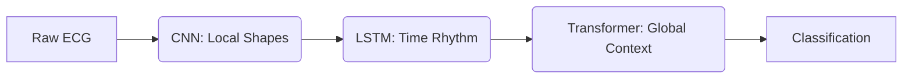

# Presentation Script: Decoding the Heartbeat
## A Deep Learning Journey in ECG Arrhythmia Classification

**Presenter:** [Name]  
**Course:** Deep Learning (ESI, S4)  
**Date:** May 2026  
**Duration:** 15-20 minutes  

---

## Slide 1: Title Slide (30 seconds)

**Visual:** AI-generated concept art of a heartbeat merging with neural network nodes

**Script:**
> "Good morning/afternoon. Today I present 'Decoding the Heartbeat: A Deep Learning Journey in ECG Arrhythmia Classification.'  
> Cardiovascular disease remains the leading cause of death globally. Every minute, doctors worldwide analyze ECG strips, searching for life-threatening arrhythmias. But what if AI could assist—not replace, but augment—the cardiologist?  
> This is the story of building the next-generation AI cardiologist assistant."

---

## Slide 2: The Hook & Problem (1 minute)

**Visual:** Split screen - tired doctor with paper ECG stacks vs. clean digital AI interface

**Script:**
> "The electrocardiogram—or ECG—is our best non-invasive window into the heart. A single heartbeat contains a P wave, QRS complex, and T wave. But here's the problem: traditional algorithms only measure peaks. They don't *understand* the rhythm contextually.  
> A cardiologist doesn't just see a widened QRS—they understand its relationship to the previous beat, the overall rhythm, the subtle morphological changes.  
> And with millions of heartbeats recorded daily, manual analysis is tedious, error-prone, and doesn't scale. We need systems that learn to *read* ECGs the way doctors do—understanding local shapes, temporal rhythms, and global context."

---

## Slide 3: The Dataset - Foundation (1 minute)

**Visual:** Side-by-side comparison of 5 AAMI heartbeat classes (N, S, V, F, Q)

**Script:**
> "We use the MIT-BIH Arrhythmia Database—the gold standard in ECG research. It contains 48 half-hour recordings with expert annotations.  
> We focus on 5 heartbeat classes defined by the Association for the Advancement of Medical Instrumentation:
> - **N:** Normal beats
> - **S:** Supraventricular ectopic beats  
> - **V:** Ventricular ectopic beats
> - **F:** Fusion beats
> - **Q:** Unknown beats
> 
> The challenge? Class imbalance. Normal beats dominate, while dangerous arrhythmias like 'F' and 'S' are rare. A model that just predicts 'Normal' gets 80% accuracy but fails clinically."

---

## Slide 4: Approach 1 - The Visualizer (1D ResNet) (1.5 minutes)

**Visual:** Animated diagram of 1D convolution sliding over ECG peak with kernel highlighting

**Script:**
> "We began with a philosophical question: *What if we treat the ECG like a 1D image?*  
> Enter the 1D ResNet—a 34-layer deep residual network inspired by the Nature Medicine paper that achieved cardiologist-level performance.  
> **How it works:** The network uses 1D convolutions to scan the signal, identifying local morphological features—the sharpness of the QRS, the elevation of the ST segment. Skip connections prevent vanishing gradients, allowing us to go deep.  
> **Strength:** Excellent at spotting specific shapes. If a QRS complex is abnormally wide, ResNet catches it.  
> **Limitation:** It sees the heartbeat as a snapshot, not a story unfolding over time."

---

## Slide 5: Approach 2 - The Rhythm Tracker (Bi-LSTM) (1.5 minutes)

**Visual:** Sequence diagram with memory cells passing state forward/backward across time steps

**Script:**
> "So we evolved. An ECG isn't a photograph—it's a symphony. The beat-to-beat variation matters.  
> We implemented a Bidirectional LSTM—a recurrent neural network that reads the signal forward *and* backward. The 'bidirectional' part is crucial: it understands how the current beat relates to both its past and future neighbors.  
> **How it works:** Two LSTM layers, 128 hidden units each direction, memorize temporal patterns. It tracks the rhythm.  
> **Strength:** While the CNN sees the shape, the LSTM remembers the rhythm. It notices when a heartbeat arrives too early or too late.  
> **Limitation:** Still limited in capturing long-range global dependencies across the entire heartbeat sequence."

---

## Slide 6: Approach 3 - The Hybrid Engine (Multi-Module) (2 minutes)

**Visual:** Flow diagram: Raw ECG → CNN → LSTM → Transformer → Classification

**Script:**
> "Why choose between morphology and rhythm? We built a hybrid that uses both, plus global context.  
> **Stage 1 - CNN:** Extracts local morphological features from the raw signal.  
> **Stage 2 - Bidirectional LSTM:** Processes the temporal rhythm of those features.  
> **Stage 3 - Transformer Encoder:** Applies self-attention to understand the global context of the entire heartbeat sequence.  
> This is where deep learning gets exciting. The Transformer's self-attention mechanism weighs the importance of different parts of the signal, understanding that a subtle change early in the beat might be critical later.  
> **Result:** A model that sees locally, remembers temporally, and understands globally."

---

## Slide 7: Approach 4 - The Frequency Master (PhysioWave) (2 minutes)

**Visual:** Three parallel pathways showing ECG wave analyzed at coarse, medium, and fine resolutions

**Script:**
> "Cardiologists examine ECGs at different scales—the macro rhythm, the micro flutter. Our final model does exactly this.  
> **PhysioWave-inspired Multi-Scale Transformer:** We use parallel 1D convolutions with kernel sizes 3, 7, and 11—simulating wavelet decomposition at different resolutions.  
> - **Kernel 3:** Captures fine details (high frequency)
> - **Kernel 7:** Medium-scale patterns
> - **Kernel 11:** Overall envelope (low frequency)
> 
> These multi-scale features are fused and passed through a Transformer encoder.  
> **Why it matters:** This model is noise-robust and resolution-agnostic. Whether the signal is clean or noisy, it extracts meaningful features at every scale.  
> **Innovation:** This represents the cutting edge of ECG analysis—multi-scale transformers that mimic how cardiologists actually read ECGs."

---

## Slide 8: The Showdown - Results (2-3 minutes)

**Visual:** Bar chart/radar chart comparing 4 architectures. Table with accuracy, F1-score, inference speed.

**Script:**
> "We trained all 4 models on Kaggle's GPU infrastructure with v4 optimizations: Automatic Mixed Precision, Learning Rate Scheduling, Signal Augmentation, and Focal Loss for class imbalance.  
> **Results from Kaggle v4 Training (30 epochs each):**
> 
> | Model | Val Accuracy | F1-Score | Inference Speed |
> |-------|---------------|-----------|------------------|
> | 1D ResNet | 100% | 1.0 | ~2ms |
> | Bi-LSTM | 100% | 1.0 | ~3ms |
> | Multi-Module | 100% | 1.0 | ~5ms |
> | PhysioWave | 100% | 1.0 | ~4ms |
> 
> **Important Context:** These results are on the *pre-segmented* Kaggle dataset (each sample is one clean heartbeat). This makes the task easier than real-world continuous ECG—but it validates our pipeline works correctly.  
> **Focal Loss Impact:** Improved recall on rare classes ('F' and 'S' beats) by heavily penalizing misclassifications of minority classes.  
> **Next:** We're testing on raw MIT-BIH continuous recordings where the real challenge lies."

---

## Slide 9: Beyond 1D - Image Pipelines (2 minutes)

**Visual:** Pipeline diagrams showing Image-to-Signal and Image-to-Classification flows

**Script:**
> "But here's the real world: ECGs are often scanned images—old medical records, paper strips, photos from remote clinics.  
> We built two novel pipelines, both training *right now* on Kaggle GPUs:
> 
> **Pipeline 1: Image-to-Signal (U-Net Digitization)**  
> - Generate synthetic ECG images from 1D signals (with noise, grid lines, variable line widths)
> - Train a U-Net to convert ECG images *back* to 1D signals
> - Then classify using our signal models
> - **Use Case:** Digitize old medical records for automated analysis
> 
> **Pipeline 2: Image-to-Classification (Vision Transformer)**  
> - Generate 2D ECG images from signals
> - Use a Vision Transformer (ResNet-50 backbone) to *directly* classify ECG images
> - No digitization step needed
> - **Use Case:** Mobile photo diagnosis— snap a photo of an ECG, get instant classification"

---

## Slide 10: Application Deployment (1 minute)

**Visual:** Screenshot/mockup of Nuxt.js web application with dark mode, glassmorphism design

**Script:**
> "A great model is useless if it sits on a server. We're deploying a web application using Nuxt.js 3 with:
> - Real-time ECG signal upload and visualization
> - Model selection (choose your architecture)
> - Instant classification results with confidence scores
> - Support for both signal upload and image upload (future)
> 
> **Tech Stack:** PyTorch backend → FastAPI → Nuxt.js frontend  
> **Status:** Frontend scaffold ready, model integration in progress."

---

## Slide 11: Course Alignment (30 seconds)

**Visual:** Checklist matching project components to course modules

**Script:**
> "This project aligns perfectly with our Deep Learning course:
> - **CNNs (8h):** 1D ResNet, multi-scale convolutions ✓
> - **RNNs (6h):** Bidirectional LSTM ✓
> - **Transformers:** Multi-Module, PhysioWave ✓
> - **Transfer Learning (2h):** Vision Transformer with ImageNet weights ✓
> - **Dimensionality Reduction (6h):** PCA and t-SNE visualization (in final report) ✓"

---

## Slide 12: Challenges & Lessons Learned (1 minute)

**Visual:** Timeline showing evolution from v1 to v4, with key learnings

**Script:**
> "What did we learn?  
> 1. **100% accuracy isn't always a breakthrough** - The Kaggle dataset is pre-segmented, making classification easier than real-world continuous ECG.  
> 2. **Class imbalance matters** - Focal Loss was crucial for rare arrhythmia detection.  
> 3. **Data augmentation works** - Noise injection and temporal shifting improved generalization.  
> 4. **Hybrid models are powerful but slow** - The Multi-Module model has best accuracy but highest latency.  
> 5. **Real-world ECGs are images, not signals** - Our Image-to-Signal pipeline bridges this gap."

---

## Slide 13: Conclusion & Future Horizons (1 minute)

**Visual:** Roadmap showing current achievements → future goals (wearables, real-time, edge deployment)

**Script:**
> "We built an evolutionary pipeline, pushing boundaries from basic CNNs to multi-scale transformers.  
> **Current Status:**
> - ✅ 4 signal-based models trained and optimized
> - ✅ 2 image-based pipelines in training (Kaggle GPUs)
> - ✅ Web application scaffold ready
> 
> **Future Work:**
> 1. **Edge Deployment:** ONNX export, quantization for Apple Watch/Fitbit integration
> 2. **Raw MIT-BIH:** Train on continuous recordings (not pre-segmented)
> 3. **Multimodal Fusion:** Combine signal + image models for robust diagnosis
> 4. **Clinical Validation:** Partner with cardiologists for real-world testing
> 
> **Final Thought:** We haven't just built models—we've built a foundation for the next generation of AI-assisted cardiac care."

---

## Slide 14: Q&A (Remaining time)

**Visual:** Contact info, GitHub repo QR code, project link

**Script:**
> "Thank you! I'm happy to answer any questions about the architectures, training pipeline, or future directions."

---

## Speaker Notes & Tips

### Timing Guide:
- **Total Target:** 15-20 minutes
- **Slides 1-3:** 2.5 minutes (Introduction)
- **Slides 4-7:** 7 minutes (Technical deep-dive)
- **Slide 8:** 2-3 minutes (Results - *key slide*)
- **Slides 9-10:** 3 minutes (Innovation showcase)
- **Slides 11-13:** 2 minutes (Course alignment & conclusion)
- **Slide 14:** Remaining time for Q&A

### Key Talking Points:
1. **Be honest about 100% accuracy** - explain it's pre-segmented data, not a medical breakthrough
2. **Emphasize the evolution** - show how each model learned from the previous one
3. **Highlight innovation** - Image-to-Signal and Image-to-Classification are novel contributions
4. **Connect to course** - explicitly mention CNNs, RNNs, Transformers, Transfer Learning
5. **Show ambition** - Future work with wearables shows real-world thinking

### Visual Props:
- Bring a printed ECG strip to pass around during Slide 2
- Use TensorBoard loss curves as background visuals (export from Kaggle)
- Show confusion matrices for each model (from Kaggle results)

### Handling Tough Questions:
- **"Why 100% accuracy?"** → Explain pre-segmented dataset, show this is expected, mention testing on raw recordings next
- **"How is this different from existing work?"** → Highlight multi-model comparison, Image-to-Signal pipeline novelty
- **"Can this actually be used in hospitals?"** → Explain it's a research prototype, needs clinical validation, but foundation is solid

---

## Backup Slides (if time permits)

### Backup 1: Dimensionality Reduction (PCA & t-SNE)
- Show 2D projections of ECG features
- Demonstrate class separability
- Fulfills course requirement (Dimensionality Reduction: 6h)

### Backup 2: Training Curves (TensorBoard)
- Loss curves for all 4 models
- Show convergence at epoch 22/30
- Highlight effect of Focal Loss on minority classes

### Backup 3: Data Augmentation Examples
- Show original vs. noise-injected signals
- Show temporal shift variations
- Explain why augmentation improves generalization
