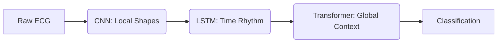

# Pitch Deck Draft: Decoding the Heartbeat

## Presentation Flow & Story Arc

**Theme:** Evolving from simple feature extraction to deep contextual understanding of the human heart.
**Tone:** Professional, Visionary, Technically Deep, yet accessible through storytelling.

---

### Slide 1: Title Slide
*   **Title:** Decoding the Heartbeat: A Deep Learning Journey in ECG Arrhythmia Classification
*   **Subtitle:** Building the Next-Generation AI Cardiologist Assistant
*   **Visual:**
*(concept image not included in the repository)*

### Slide 2: The Hook & The Problem
*   **Story:** Cardiovascular disease is the leading cause of death globally. The ECG is our best window into the heart, but analyzing millions of heartbeats is tedious and error-prone. 
*   **The Problem:** Traditional algorithms miss subtle morphological changes. We need a system that doesn't just "measure" peaks, but *understands* the rhythm contextually.
*   **Visual:** Split screen: A tired doctor looking at miles of paper ECG vs. a modern, clean digital interface.

### Slide 3: The Dataset (The Foundation)
*   **Content:** MIT-BIH Arrhythmia Database. The gold standard.
*   **Technical Depth:** Discuss the 5 AAMI heartbeat classes:
    *   **N:** Normal beat
    *   **S:** Supraventricular ectopic beat
    *   **V:** Ventricular ectopic beat
    *   **F:** Fusion beat
    *   **Q:** Unknown beat
*   **Visual:** Examples of the 5 different ECG waveforms side-by-side to show the visual difficulty of the classification task.

---
## The Journey (Model Evolution)
*Story Link: We didn't just throw a model at the wall. We took an evolutionary approach, testing different mathematical philosophies on how to "read" a signal.*

### Slide 4: Approach 1 - The Visualizer (1D ResNet)
*   **Philosophy:** Treat the ECG like a 1D image. Look for specific shapes (morphology).
*   **Technical Depth:** A 34-layer deep 1D Convolutional Neural Network with Residual connections to prevent vanishing gradients during deep feature extraction.
*   **Why it matters:** Excellent at finding specific local anomalies (like a widened QRS complex).
*   **Visual:** Diagram showing a 1D convolution sliding over an ECG peak.

### Slide 5: Approach 2 - The Rhythm Tracker (Bi-LSTM)
*   **Philosophy:** An ECG isn't just a picture; it's a story unfolding over time.
*   **Technical Depth:** Bidirectional Long Short-Term Memory (LSTM) network.
*   **Why it matters:** While CNNs see the shape, LSTMs remember the rhythm. It tracks the beat-to-beat variations and temporal dependencies.
*   **Visual:** A sequence diagram showing memory cells passing state forward and backward across time steps.

### Slide 6: Approach 3 - The Hybrid Engine (Multi-Module)
*   **Philosophy:** Why choose between shape and time? Let's use both, plus global context.
*   **Technical Depth:** 
    1.  **CNN** extracts local morphological features.
    2.  **LSTM** processes the temporal rhythm of those features.
    3.  **Transformer** applies self-attention to understand the global context of the entire heartbeat sequence.
*   **Visual:** 

### Slide 7: Approach 4 - The Frequency Master (PhysioWave)
*   **Philosophy:** Cardiologists look at signals at different scales (macro rhythm vs micro flutters). Our model should too.
*   **Technical Depth:** A novel Multi-Scale Wavelet Transformer. It uses parallel convolutions with different kernel sizes (3, 7, 11) to simulate wavelet decomposition, fused into a Transformer encoder.
*   **Why it matters:** Provides ultra-high resolution feature extraction, robust to noise and varying patient baselines.
*   **Visual:** Three parallel pathways showing an ECG wave being analyzed at coarse, medium, and fine resolutions simultaneously.

---

### Slide 8: The Showdown (Results & Benchmarks)
*   **Content:** *(Waiting on Kaggle Results to populate this slide)*
*   **Metrics:** Accuracy, F1-Score (crucial for imbalanced classes like 'F' and 'S'), and Inference Speed.
*   **Visual:** A beautiful, animated bar chart or radar chart comparing the 4 architectures.

### Slide 9: Beyond the Backend (The Application)
*   **Story Link:** A great model is useless if it sits on a server. It needs to be in the hands of clinicians.
*   **Content:** Showcasing the Web Application interface. 
*   **Design Aesthetics:** Dark mode, glassmorphism, real-time signal plotting.
*   **Visual:** 
*(mockup image not included in the repository)*

### Slide 10: Conclusion & Future Horizons
*   **Summary:** We built an evolutionary pipeline, pushing the boundaries from basic CNNs to multi-scale transformers.
*   **Future:** Integration with wearable devices (Apple Watch, Fitbit) for real-time edge inference.
*   **Call to Action / Q&A.**

---

## Action Items for Pitch Prep:
1.  [ ] Collect final accuracy data from Kaggle run.
2.  [ ] Generate AI concept art for Slide 1 and Slide 9.
3.  [ ] Extract TensorBoard loss curves to use as background visuals.
